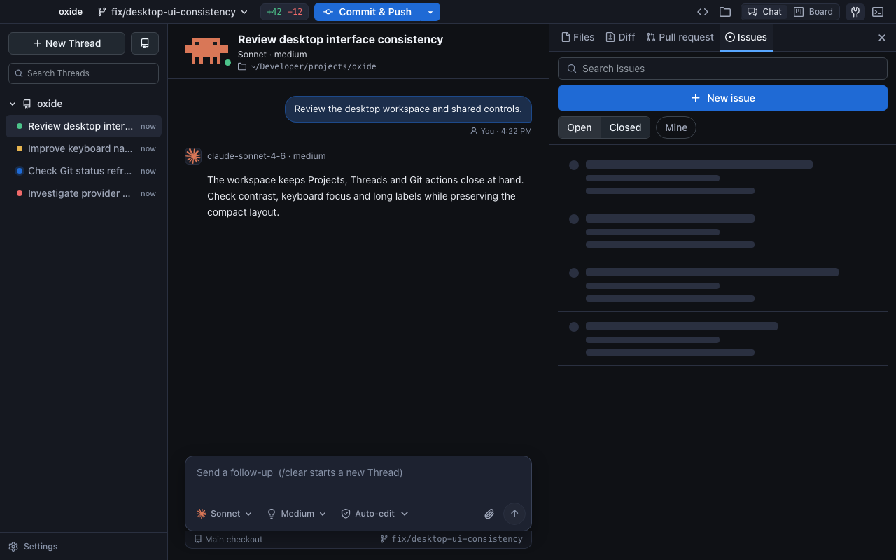
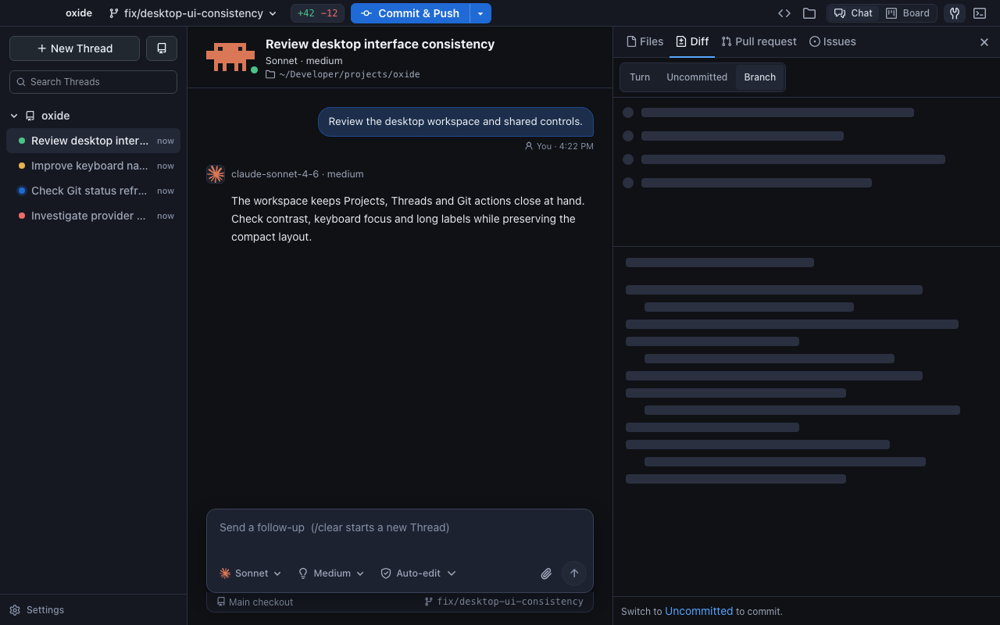
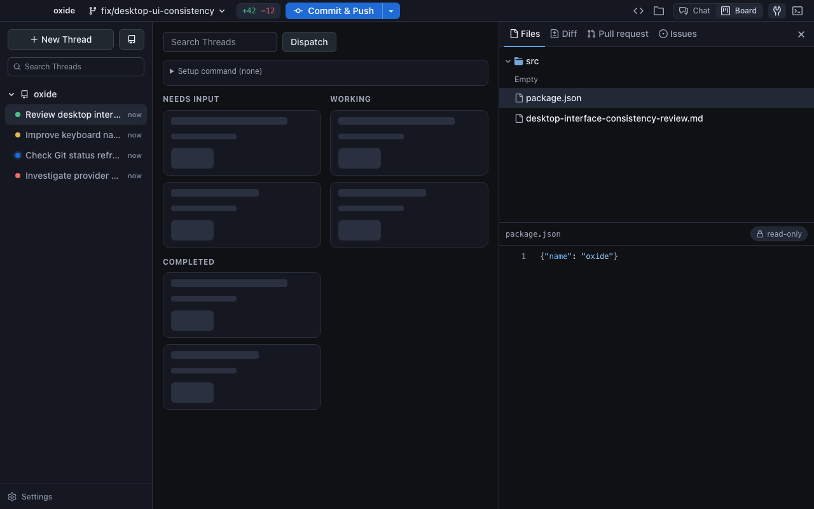

# Loading skeletons

Content-shaped placeholders now replace text-only waits in Issues and pull request lists/details, issue templates, dispatch settings, directory listings, file content, diffs, the Thread Board, branch/people/model/effort pickers, and Transcript loading (including older paged Turns). Lazy tools also show a skeleton while their JavaScript loads.

Shapes use Oxide's existing surface colors and content layouts. Each region pulses with one opacity animation; reduced motion keeps static shapes, and hidden/offscreen regions pause. Skeletons expose a single loading status and no focusable controls. Cached data stays visible during background refresh. Existing action feedback (saving, merging, sending) and the startup splash retain their current behavior.

| Surface | Loading capture |
| --- | --- |
| Issue list | [Loading](issues-loading.png), [ready](issues-ready.png) |
| Issue detail | [Title, metadata, body and people](issue-detail-loading.png) |
| Issue creation | [Form](issue-form-loading.png) |
| Diff | [Wide](diff-loading.png), [compact](diff-loading-compact.png) |
| Files | [Directory](directory-loading.png), [file content](file-loading.png) |
| Board | [Responsive columns and cards](board-loading.png) |
| Branch picker | [Compact rows](branches-loading.png) |
| Transcript | [Prompt and response](transcript-loading.png) |
| Reduced motion | [Static shapes](reduced-motion.png) |







## Verification

- `pnpm --dir web build`: passed (includes TypeScript).
- `pnpm --dir web test`: 56 files, 348 tests passed. Loading tests cover first load, empty/error completion, cached revisits and Project/filter isolation.
- `pnpm --dir web lint`: no errors; three existing hook warnings in ModelEffortPicker/ThreadView.
- Chromium: ten real React loading states with held synthetic IPC, 1280×800 and compact diff at 900×560. Checked status semantics, no focusable skeleton content, horizontal containment, distinct animation poses, reduced motion, hidden-window pause/resume, and immediate replacement by loaded results. No browser errors. See [verification-chromium.json](verification-chromium.json).
- The review helper explicitly opens tools/Terminal: main now starts with both closed.

Reproduce from `web/`, with Vite on port 1421 and Playwright installed:

```sh
OXIDE_REVIEW_URL=http://127.0.0.1:1421 \
OXIDE_PLAYWRIGHT_MODULE=/path/to/playwright/index.mjs \
node scripts/skeleton-review.mjs
```

## Final release validation (manual, pending)

One consolidated pass on packaged Windows and macOS: open a cold Project; switch Threads, scroll older Turns, open Board and dispatch; load/search GitHub lists and details, open people/model/effort pickers; expand directories, read files and switch diff scopes. Include slow/offline GitHub, empty results, rapid Project switching, narrow windows and reduced motion. Confirm content replaces placeholders promptly, cached refreshes stay readable, keyboard focus remains on real controls, and hiding the window pauses motion. Native WebView behavior and assistive-technology announcements remain part of this release pass; the browser captures use deterministic IPC rather than live services.
